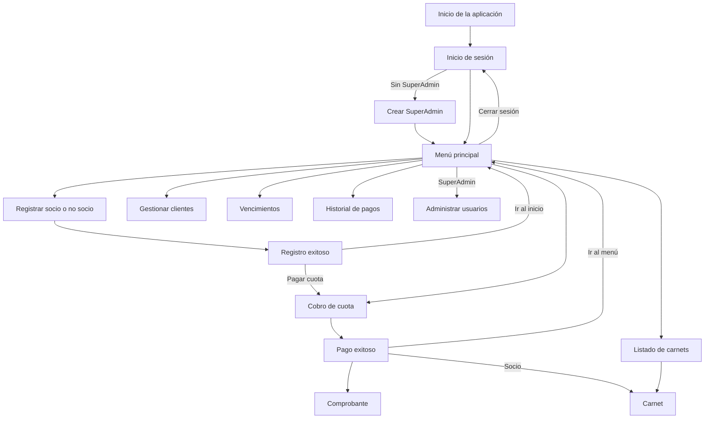
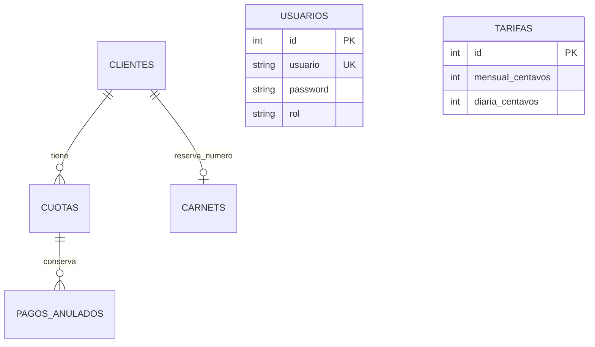

# Documentación funcional de Club Deportivo Focus

**Aplicación Android · Versión 1.0 · Revisión analizada `bf46517`**  
**Relevamiento actualizado al 18 de noviembre de 2026**

Club Deportivo Focus centraliza la operatoria de atención del club. Desde un dispositivo Android, el personal puede registrar socios y no socios, actualizar sus datos, registrar cobros y consultar cuotas, comprobantes y carnets. El SuperAdmin también puede gestionar las cuentas del personal.

Este documento toma como base la revisión `bf46517` del repositorio personal e incorpora los cambios locales de acceso, cobro, alta, vencimientos, reingreso de socios, comprobantes y validación de fichas (H01 a H08). Está dirigido a quienes operan, mantienen o prueban la aplicación. Las reglas se relevaron en el código, las pantallas XML y la base SQLite.

## Índice

1. [Alcance y actores](#1-alcance-y-actores)
2. [Circuitos de atención y navegación](#2-circuitos-de-atención-y-navegación)
3. [Requisitos y casos de uso](#3-requisitos-y-casos-de-uso)
4. [Reglas de negocio](#4-reglas-de-negocio)
5. [Datos y persistencia](#5-datos-y-persistencia)
6. [Verificación funcional](#6-verificación-funcional)
7. [Hallazgos y decisiones pendientes](#7-hallazgos-y-decisiones-pendientes)
8. [Fuentes del relevamiento](#8-fuentes-del-relevamiento)

## 1 Alcance y actores

El sistema cubre la atención presencial. El operador registra el resultado del cobro en el dispositivo, exporta comprobantes y carnets vigentes como PDF y consulta los datos desde el menú principal. El registro de pagos es local y la aplicación carece de una integración con terminales de tarjetas o servicios de pago.

| Actor | Responsabilidad |
| --- | --- |
| Administrador | Inicia sesión y realiza la operatoria de clientes, cuotas y carnets. |
| SuperAdmin | Realiza la operatoria del Administrador. Además, crea, lista y elimina cuentas con rol Administrador. |
| Cliente socio | Persona registrada con condición de socio y número de socio. Recibe una cuota mensual y puede obtener un carnet tras el pago. |
| Cliente no socio | Persona registrada para la atención con cuota diaria. |

Socios y no socios son personas registradas por el personal. El inicio de sesión corresponde a las cuentas internas del sistema.

| Función | Administrador | SuperAdmin |
| --- | --- | --- |
| Iniciar y cerrar sesión | Sí | Sí |
| Registrar, consultar, editar, asociar y dar de baja como socio | Sí | Sí |
| Registrar cuotas y consultar comprobantes | Sí | Sí |
| Consultar carnets, historial y vencimientos | Sí | Sí |
| Crear, listar y eliminar administradores | — | Sí |
| Crear y restaurar copias de seguridad | — | Sí |
| Consultar el resumen diario de caja | — | Sí |
| Configurar las tarifas mensual y diaria | — | Sí |

## 2 Circuitos de atención y navegación

Para un alta con cobro en el mismo momento, el operador completa el formulario, confirma el registro y elige **Pagar cuota**. Para cobrar a un cliente que ya existe, abre **Cobro de cuota** desde el menú y lo busca por DNI exacto. En ambos casos, la confirmación permite abrir el comprobante y, si corresponde a un socio, el carnet.

## 3 Requisitos y casos de uso

### RF01 Iniciar y cerrar sesión

El Administrador o el SuperAdmin ingresa con su usuario y contraseña. Si la instalación todavía carece de un SuperAdmin, la pantalla de acceso solicita crear esa cuenta.

1. Al abrir la aplicación se presenta la pantalla de inicio de sesión después de la animación del logo.
2. En la configuración inicial, la persona responsable elige el usuario y una contraseña de 12 a 128 caracteres, y vuelve a escribirla para confirmarla. Al crear la cuenta, entra al menú como SuperAdmin.
3. En los accesos posteriores, **Ingresar** recorta los espacios de los extremos del nombre de usuario y valida la contraseña sin modificarla. Si las credenciales coinciden con una cuenta local, guarda el usuario y el rol de la sesión y abre el menú.
4. Campos vacíos y credenciales incorrectas tienen avisos diferentes. La opción de contraseña olvidada indica contactar al área de sistemas del club.
5. **Cerrar sesión** solicita confirmación. Al aceptar, la app borra las preferencias de sesión y vuelve al ingreso. Al cancelar, conserva la sesión abierta.

### RF02 Registrar socio o no socio

El Administrador o el SuperAdmin registra la condición, el nombre, el apellido, el DNI, la fecha de nacimiento, el correo y la presentación del apto físico.

1. En **Registrar socio**, el operador selecciona **Socio** o **No socio**. El formulario abre con **Socio** seleccionado.
2. Completa los datos y marca que la persona presentó el apto físico. La app valida campos completos, correo con formato válido, fecha con el patrón `dd/MM/yyyy` y DNI sin duplicados.
3. Al guardar, el sistema registra la fecha de inscripción del dispositivo, asigna un número si corresponde a un socio y guarda la ficha y la primera cuota pendiente en una sola operación. Si falla alguno de los dos guardados, se muestra un aviso y se mantienen los datos del formulario para volver a intentar.
4. La confirmación de registro permite abrir el cobro con el cliente ya seleccionado o volver al menú. Si se vuelve al menú, la cuota permanece pendiente y se puede recuperar más adelante desde **Cobro de cuota** buscando por DNI.

### RF03 Consultar y editar clientes

El Administrador o el SuperAdmin puede editar la ficha de un cliente registrado.

1. En **Gestionar Clientes**, el operador escribe todo o parte del DNI. La lista se filtra mientras escribe. Al seleccionar una coincidencia se abre la ficha.
2. **Editar datos personales** habilita nombre, apellido, DNI, fecha de nacimiento, correo y apto físico. **Cancelar edición** recupera los valores de la ficha previa.
3. Al guardar, se exigen nombre, apellido, DNI, fecha de nacimiento, correo válido y el indicador de apto físico presentado. Si se modifica el DNI, debe seguir siendo único. La fecha se ingresa con el patrón `dd/MM/yyyy`, debe existir en el calendario y ser hasta el día actual. El alta aplica el mismo control.
4. Si se actualiza el registro, la app vuelve a cargar la ficha y muestra una confirmación.

### RF04 Asociar o dar de baja como socio

El Administrador o el SuperAdmin aplica el cambio desde la ficha del cliente seleccionado.

Para asociar, la ficha debe tener un correo válido y el apto físico marcado. Si falta alguno de los dos, la aplicación pide editar la ficha. Una vez guardados los datos, se puede volver a intentar la asociación.

| Acción | Cambio en el cliente | Cambio en la cuota |
| --- | --- | --- |
| Asociar cliente | Pasa a socio. Conserva su número anterior o recibe uno si todavía no lo tenía. Si tiene una cuota mensual pagada vigente, recupera el carnet hasta el vencimiento de esa cuota. | La última pendiente pasa a mensual con la tarifa vigente, con vencimiento a un mes desde la asociación. |
| Dar de baja como socio | Pasa a no socio. Conserva su número y la ficha personal. El carnet queda inhabilitado. | La última pendiente pasa a diaria con la tarifa vigente, con vencimiento el día de la baja. |

Los cambios se aplican al tocar el botón correspondiente. Si existe una cuota pendiente o vencida, se actualiza la de mayor identificador con el tipo, la tarifa y el vencimiento de la nueva condición. Su estado vuelve a pendiente con la nueva fecha. Si no existe, el cambio de condición se guarda y la operación termina sin generar una cuota nueva. Las cuotas pagadas mantienen su tipo e importe.

### RF05 Registrar el pago de una cuota

El Administrador o el SuperAdmin identifica al cliente, elige el medio de pago y puede aplicar una promoción.

1. Abrir **Cobro de cuota** e ingresar el DNI exacto, o llegar desde el alta. La pantalla informa si encuentra al cliente y carga su cuota impaga más antigua, pendiente o vencida, según el identificador.
2. Si no hay cuota impaga, el sistema busca una cuota pagada vigente. Si la encuentra, informa que ya está paga. En caso contrario, intenta generar una pendiente y usa el identificador asignado por SQLite para cobrarla. Si falla la generación, informa el error y la confirmación sigue deshabilitada (H01).
3. La pantalla muestra concepto, importe base, descuento e importe final. Efectivo queda seleccionado al cargar la cuota. El operador puede elegir tarjeta de débito o de crédito. Las promociones se habilitan con crédito.
4. Al confirmar, se actualiza la cuota con estado pagada, fecha de pago, monto final, medio y promoción. Si es mensual, el nuevo vencimiento es un mes calendario desde el pago. La misma transacción actualiza la habilitación del cliente y crea o renueva el carnet cuando corresponde. Un fallo del carnet revierte el cobro completo para permitir el reintento. Si la cuota cambió de importe o tipo desde que se cargó en pantalla, se rechaza la confirmación para volver a consultar sus datos.

Si el operador cambia el DNI, la pantalla limpia el cobro cargado y deshabilita la confirmación hasta que se vuelva a encontrar una cuota cobrable (H03).

### RF06 Consultar comprobante y carnet

- **Comprobante de pago.** Se abre desde la confirmación del cobro con el identificador de esa cuota. La fecha, el concepto, el importe final, el medio y la promoción salen del pago registrado. El nombre y el DNI salen de la ficha actual vinculada a esa cuota. Si el pago falta o la cuota todavía está impaga, se muestra un aviso y se vuelve a la pantalla anterior (H06).
- **PDF del comprobante.** Desde **Ver comprobante → PDF del comprobante**, el operador puede abrir el PDF en un visor compatible, elegir dónde guardarlo o seleccionar una aplicación para compartirlo. El archivo se sugiere como `Comprobante-Focus-<id de cuota>.pdf` y contiene los datos mostrados en el comprobante, más el número de cuota. Si se cancela el selector de guardado, la app vuelve al comprobante.
- **Carnet del socio.** Se abre desde la confirmación de un pago de socio o desde **Carnets**. El listado se ordena por apellido y permite buscar por DNI parcial. El detalle muestra número, nombre, fecha de emisión y fecha de vencimiento. Las bajas y los reingresos sin cuota mensual vigente dejan el carnet fuera de la consulta. Si la fecha del carnet ya pasó, el botón de exportación queda deshabilitado.
- **PDF del carnet.** Desde **PDF del carnet**, el operador puede abrirlo en un visor, guardarlo o compartirlo. El archivo incluye el logo, el nombre, el número de socio y las fechas. El nombre sugerido es `Carnet-Focus-<número de socio>.pdf`. La app vuelve a comprobar la habilitación y la vigencia antes de generar el archivo.

### RF07 Consultar el historial de pagos

Desde **Historial de pagos**, el operador consulta cuotas pagadas, pendientes y vencidas que tengan un cliente relacionado. Las pagadas aparecen primero, con las fechas de pago más recientes arriba. El buscador acepta parte del DNI. Al ejecutar la búsqueda con el campo vacío se recupera el listado completo.

Las filas pagadas que tienen fecha y medio de pago ofrecen **Ver comprobante**. Al tocar una de esas filas se abre el comprobante de la cuota elegida, incluso si el cliente tiene pagos más recientes. Desde ese comprobante están disponibles las opciones de PDF. Las cuotas pendientes y vencidas se mantienen como filas de consulta.

Cada fila muestra nombre, DNI, concepto, vencimiento, tipo de cliente según la cuota, medio, monto final y estado. Para una cuota mensual pagada, el texto **Cuota mes año** toma el mes y el año de `fecha_pago`. La fecha de vencimiento tiene su propio campo. Para una mensual sin fecha de pago se muestra **Cuota Mensual**, y para una diaria se muestra **Cuota Diaria**.

### RF08 Consultar vencimientos

Desde **Vencimientos**, el operador consulta cuotas de clientes que actualmente son socios. El listado incluye las impagas cuya fecha de vencimiento ya pasó y las pagadas cuyo vencimiento es hoy. Estas últimas aparecen primero con la etiqueta **Vence hoy**. El operador puede filtrar por DNI parcial. Seleccionar una fila la resalta y muestra un aviso.

La cuota impaga sigue **Pendiente** durante todo su último día. Desde el día siguiente se muestra **Vencida** al consultar el listado de socios y el historial. El historial aplica la misma regla a las cuotas diarias de no socios. La aplicación calcula el estado al consultar y las cuotas pagadas conservan el estado **Pagada** (H02).

### RF09 Administrar cuentas internas

El SuperAdmin debe estar autenticado y conservar ese rol en la base local.

1. El menú muestra **Administrar usuarios** al SuperAdmin. Al entrar, la pantalla verifica nuevamente el rol consultando la base.
2. Para crear un Administrador, se ingresa un usuario único y una contraseña de 12 a 128 caracteres. El nuevo usuario queda con rol Administrador.
3. El listado se ordena por nombre de usuario. Para eliminar una cuenta se requiere confirmación. La eliminación borra físicamente la fila y se aplica solo al rol Administrador. El SuperAdmin queda fuera de esta lista.

### RF10 Crear y restaurar copias de seguridad

El SuperAdmin abre **Administración de usuarios → Copias de seguridad**. La aplicación verifica su rol antes de acceder a los datos y antes de aplicar una restauración.

1. En **Crear copia**, el operador elige y confirma una contraseña de 12 a 128 caracteres. La aplicación toma una lectura consistente de clientes, cuotas, pagos y carnets. Genera un archivo cifrado `.clubfocus` y Android permite elegir dónde guardarlo.
2. En **Restaurar copia**, selecciona el archivo e ingresa la contraseña elegida al crearlo. La aplicación valida el formato, el contenido y las referencias de las cuotas a los clientes. Si la contraseña es incorrecta o el archivo es inválido, muestra un aviso.
3. La confirmación muestra las cantidades de clientes, cuotas, cuotas pagadas y carnets. **Reemplazar datos** sustituye los registros del dispositivo en una sola transacción. Si una escritura falla, el dispositivo conserva los datos que tenía antes. **Cancelar** cierra la confirmación sin reemplazar datos.

En otro teléfono, el responsable primero crea su SuperAdmin en la app y luego restaura el archivo. Las cuentas de acceso y los PDF exportados quedan fuera de la copia. La recuperación requiere la contraseña del archivo, que se mantiene separada del inicio de sesión.

La base del club y las preferencias de sesión se excluyen de las copias automáticas de Android y del traslado automático entre dispositivos. Una instalación nueva comienza vacía y la recuperación de datos se realiza mediante el archivo cifrado elegido por el SuperAdmin.

### RF11 Consultar el resumen de caja

El SuperAdmin abre **Administración de usuarios → Resumen de caja**. La aplicación verifica el rol al consultar los datos. La pantalla abre con la fecha de hoy y permite elegir otro día.

Se muestran la cantidad de cobros, el total y los subtotales de efectivo, débito y crédito. Ante un pago anterior sin medio informado, su importe aparece en un subtotal propio y se incluye en el total. El día se determina por la fecha de pago. Las cuotas impagas y los cobros anulados quedan fuera del cálculo.

El detalle permite abrir el comprobante de cada cobro que tenga los datos necesarios para emitirlo. Si no hay pagos en la fecha elegida, se muestran cero cobros y los totales en cero.

### RF12 Anular un cobro

El SuperAdmin abre el comprobante y selecciona **Anular cobro**. Para confirmar ingresa un motivo. La aplicación vuelve a verificar el rol y que el comprobante corresponda al cobro vigente de esa cuota.

El historial conserva el importe, la fecha y el medio del cobro con estado **Anulado**, junto con el motivo, el usuario y la fecha de anulación. La cuota vuelve a estar disponible para un nuevo cobro. Queda **Pendiente** hasta su vencimiento inclusive y **Vencida** desde el día siguiente. Los cobros anteriores a esta función conservan el vencimiento registrado si su fecha previa al pago no está disponible.

Al anular una mensualidad de un socio, el carnet toma la vigencia de otra mensualidad pagada que siga vigente, si la hay. Sin otra mensualidad vigente, el carnet deja de estar disponible hasta un nuevo pago. La anulación registra la corrección en la aplicación. Cualquier devolución de dinero se gestiona por separado.

Las copias nuevas incluyen las anulaciones y requieren una versión de la aplicación compatible al restaurar. Esta versión también permite restaurar las copias anteriores.

### RF13 Configurar tarifas

El SuperAdmin abre **Administración de usuarios → Configurar tarifas**. La pantalla muestra los importes mensual y diario actuales y permite guardar ambos juntos. Cada importe debe ser mayor que cero, tener hasta dos decimales y ser como máximo $999999999,99. Se admite coma o punto como separador decimal.

Los valores iniciales son $45.000 para la mensual y $20.000 para la diaria. Al guardar, las tarifas se aplican al registrar nuevos clientes y al generar cuotas posteriores desde el cobro. Las cuotas que ya están pendientes conservan su importe base. El historial conserva los importes de los pagos realizados.

Al cambiar la condición del cliente entre socio y no socio, la última cuota pendiente se recalcula con la tarifa de la nueva condición. Si se anula un pago, la cuota conserva el importe base que tenía.

Las copias de seguridad nuevas incluyen las tarifas y las restauran junto con los datos del club. Al restaurar una copia anterior que carezca de tarifas, se conservan las tarifas actuales del dispositivo.

## 4 Reglas de negocio

### Cuotas y vigencia

Las fechas de generación, pago y vencimiento cumplen funciones distintas en los cobros y las consultas.

| Regla | Comportamiento en la revisión analizada |
| --- | --- |
| RN01 Identidad | El DNI identifica de forma única a un cliente. El número de socio es único cuando está asignado. La numeración usa el prefijo `CAR100` y calcula el siguiente sufijo a partir de los números guardados en clientes y carnets. |
| RN02 Correo y apto físico | El correo válido y el apto físico declarado son obligatorios al registrar, editar o asociar un cliente. Se guarda un indicador, sin adjuntar un archivo del certificado. |
| RN03 Cuota mensual | Importe base según la tarifa mensual al generarse. El valor inicial es `$45.000`. Mientras está impaga, su vencimiento inicial se fija a un mes desde la generación. La vigencia pagada se cuenta desde el cobro. |
| RN04 Cuota diaria | Importe base según la tarifa diaria al generarse. El valor inicial es `$20.000`. Al prepararla, su vencimiento es el día actual. |
| RN05 Cuota vigente | Una cuota pagada está vigente hasta el final de su día de vencimiento. Al evaluar un nuevo cobro, se busca primero una cuota pendiente o vencida. Si no se encuentra, se comprueba la vigencia de una cuota del tipo que corresponde a la condición actual. |
| RN06 Fecha de vencimiento al cobrar | Al pagar una cuota mensual, vence un mes calendario después de la fecha de pago. Si el mes siguiente tiene menos días, vence en su último día. La diaria vence el mismo día del pago, también cuando se vuelve a cobrar tras una anulación. |
| RN06a Actualización de cuotas diarias | Al actualizar desde una base anterior a la versión 4, las diarias pagadas toman como vencimiento su fecha de pago registrada. Los registros de cobros anulados conservan sus fechas originales. |
| RN07 Carnet | Un pago mensual de socio emite o renueva el carnet con el mismo vencimiento que la cuota pagada. En el reingreso, si la cuota mensual anterior sigue pagada y vigente, se recupera el mismo carnet con las fechas de ese pago. Si la cuota ya venció, la habilitación espera al siguiente cobro mensual. |
| RN08 Cambio de condición | La última cuota pendiente se recalcula para la nueva condición con la fecha del cambio. El número de socio permanece reservado en la ficha al dar la baja. |
| RN09 Transición a vencida | Si sigue impaga, la cuota pasa a mostrarse vencida a partir del día siguiente a su fecha límite, según la fecha del dispositivo. Si después se registra el cobro, pasa a pagada. |
| RN10 Comprobante por cuota | Cada comprobante toma los datos del pago de una cuota identificada. Si la cuota ya se pagó, un nuevo intento de confirmación queda rechazado y conserva los datos del cobro. |
| RN11 Alta y primera cuota | La ficha y la cuota inicial pendiente se guardan juntas. El cobro puede registrarse en el momento o más adelante. |

Si una cuota mensual se genera el 16/11/2026 y se cobra el 18/11/2026, el historial muestra **Cuota Noviembre 2026**. La cuota y el carnet vencen el **18/12/2026**. Un pago mensual del 31/01/2026 vence el **28/02/2026**.

### Medios de pago y promociones

Los siguientes ejemplos usan las tarifas iniciales. Los descuentos se calculan sobre el importe base guardado en cada cuota.

| Medio y promoción | Descuento | Total mensual | Total diario |
| --- | ---: | ---: | ---: |
| Efectivo, débito o crédito sin promoción | 0 % | $45.000 | $20.000 |
| Crédito en 3 cuotas | 15 % | $38.250 | $17.000 |
| Crédito en 6 cuotas | 10 % | $40.500 | $18.000 |

El descuento se calcula sobre el importe base de la cuota elegida. El resultado se redondea a dos decimales antes de guardarlo. La app guarda el importe final y la opción de promoción elegida. Los importes se muestran con el símbolo `$`. Las tarifas se configuran desde el panel del SuperAdmin y los porcentajes se definen en las reglas de cálculo.

## 5 Datos y persistencia

La aplicación usa Kotlin, pantallas Android en XML y almacenamiento local SQLite. El proyecto declara Android API 26 como mínimo y SDK 37 para compilación y destino. La base se llama `ClubFocus.db`, versión `6`. Se crea con las tarifas iniciales y la primera cuenta se da de alta desde la aplicación.

SQLite aplica las claves foráneas en cada conexión. Una cuota requiere un cliente existente, un carnet requiere el número de un cliente y una anulación requiere su cuota. La actualización a versión 6 agrega índices para buscar cuotas por cliente y estado, consultar la caja por fecha y relacionar las anulaciones con sus cuotas.

Las tarifas se guardan como configuración del club. Cada cuota conserva su propio importe base, que permite respetar el precio con el que se generó. El nombre del usuario que anuló un cobro forma parte de su historial y se conserva aunque se elimine la cuenta del personal.

| Entidad | Identificación y relación | Datos de interés funcional |
| --- | --- | --- |
| `usuarios` | `id` y `usuario` único | Usuario, rol y hash de contraseña PBKDF2-HMAC-SHA256 con 600.000 iteraciones y sal aleatoria individual. La sesión guarda usuario y rol en `ClubFocusPrefs`. |
| `clientes` | `id`, DNI único y `nro_socio` único si está informado | Nombre, apellido, fecha de nacimiento, correo, apto físico, inscripción, condición y marca `activo`. |
| `cuotas` | `id` y `cliente_id` relacionado con `clientes.id` | Tipo, importe base, importe final, fecha de pago, vencimiento, medio, promoción y estado. Puede haber varias cuotas por cliente. |
| `tarifas` | Una fila con `id = 1` | Importes mensual y diario en centavos. La actualización a versión 5 agrega los valores iniciales. |
| `pagos_anulados` | `id` y `cuota_id` relacionado con `cuotas.id` | Copia del cobro anulado, fecha de anulación, usuario y motivo. |
| `carnets` | `id` y `nro_socio` único relacionado con `clientes.nro_socio` | Fecha de emisión y vencimiento. Se recupera junto con los datos del socio. |

`es_socio` determina la condición del cliente. `activo` habilita la consulta del carnet de un socio con un pago mensual o tras recuperar una vigencia al reingresar. La baja pone la marca en `0`. Para un no socio, registrar un pago pone `activo` en `1` y la consulta de carnet sigue inhabilitada por su condición. Los estados almacenados de cuota son `PENDIENTE`, `PAGADA` y `VENCIDA`. Una cuota pendiente se crea con fecha de pago, medio y promoción vacíos. Las fechas de operación dependen del reloj local del dispositivo.

El menú y los listados operan sobre la base local. El código relevado no incluye sincronización de datos entre dispositivos, edición de tarifas desde la pantalla, anulación de pagos ni exportación desde el historial.

La copia manual usa AES-256-GCM y una clave derivada de la contraseña con PBKDF2-HMAC-SHA256. Cada archivo emplea una sal y un vector de inicialización aleatorios. El formato inicial admite archivos de hasta 16 MiB.

Al actualizar una instalación con base versión `1`, la app convierte las contraseñas de las cuentas existentes a hash y retira las cuentas con las credenciales exactas de demostración. Si tras la migración falta un SuperAdmin, la pantalla pide crearlo. Los clientes, cuotas y carnets que ya estaban guardados se conservan, incluidos los datos de muestra que una versión anterior haya llegado a cargar. La app no puede identificar con seguridad qué fichas pudieron reutilizarse o editarse después de su creación.

## 6 Verificación funcional

Abrir la raíz del proyecto en Android Studio, sincronizar Gradle, seleccionar un emulador o dispositivo con Android API 26 o superior y ejecutar la configuración `app`. Usar datos ficticios. Para validar filas cuyo vencimiento debe ser hoy, fijar la fecha de referencia del caso y preparar los registros para ese día. Registrar fecha, dispositivo, rol, resultado real y evidencia para cada ejecución.

| Caso | Cubre | Pasos y resultado a verificar |
| --- | --- | --- |
| CP01 | RF01 | Ingresar con campos vacíos, con clave incorrecta y con una cuenta válida. Verificar los dos avisos y la apertura del menú solo con credenciales válidas. Cerrar sesión, probar primero cancelar y luego aceptar. |
| CP02 | RF02 | Registrar un socio con datos válidos y apto físico. Verificar número de socio, cuota mensual pendiente de `$45.000` y acceso a cobro desde la confirmación. |
| CP03 | RF02, RF05 | Registrar un no socio y verificar cuota diaria pendiente de `$20.000` con fecha de vencimiento del día. Volver al menú sin pagar, buscar por DNI desde Cobro de cuota y confirmar que se cobra la misma cuota. Repetir el alta con DNI duplicado, sin apto físico y con correo inválido. Verificar que se rechace. |
| CP04 | RF03 | Buscar por parte del DNI, seleccionar un resultado, editar el apellido y cancelar. Volver a editar y guardar. Verificar la persistencia y el rechazo de un DNI asignado a otra persona. |
| CP05 | RF04 | Asociar un no socio con cuota pendiente y darlo de baja después. Revisar número de socio y recalculado mensual y diario; verificar que una cuota pagada previa conserva sus valores. |
| CP06 | RF05 | Cobrar una mensual con crédito y promoción de 3 cuotas. Verificar `$38.250`, el mes del pago, el vencimiento, el medio y el estado pagado en el historial. En otra cuota mensual, elegir 6 cuotas y verificar `$40.500`. Cambiar a débito antes de confirmar y verificar que el total vuelva a `$45.000`. |
| CP07 | RF05 | Buscar un cliente sin cuota impaga y con una pagada que vence hoy. Verificar el aviso de vigencia. Repetir con un cliente sin cuota vigente y verificar que la cuota nueva quede pagada al primer intento (H01). |
| CP08 | RF06 | Cobrar a un socio, abrir comprobante y carnet, y volver a buscar el carnet por DNI parcial. Verificar fechas e identidad. |
| CP09 | RF06 | Cobrar a un no socio. Verificar el concepto diario en el comprobante y que la opción de carnet no abra el detalle. |
| CP10 | RF07 | Consultar una mensual pagada cuyo vencimiento cae al mes siguiente y una mensual pendiente. Verificar **Cuota mes año** con el mes del pago, el vencimiento por separado y **Cuota Mensual** para la pendiente. |
| CP11 | RF07, RF08 | Preparar cuotas impagas con fecha de ayer, hoy y mañana, una pagada con fecha de ayer, una pagada que vence hoy y una diaria atrasada de no socio. Verificar que solo las impagas atrasadas se ven **Vencidas** en el historial. En Vencimientos, verificar que aparecen la atrasada del socio y la pagada que vence hoy. Cobrar la atrasada y verificar su estado **Pagada** y que sale del listado. Probar el filtro por DNI parcial. |
| CP12 | RF09 | Comparar el menú de un Administrador y un SuperAdmin. Como SuperAdmin, crear una cuenta, probar usuario duplicado, cancelar una eliminación y luego confirmarla. Verificar que la cuenta eliminada ya no ingresa. |
| CP13 | RF05 | Cargar una cuota con un DNI válido y escribir a continuación uno inexistente. Verificar que la pantalla limpia el concepto y los importes, que la confirmación sigue deshabilitada tras buscar y que la cuota original continúa pendiente (H03). |
| CP14 | RF04, RF05, RF06 | Dar de baja a un socio y verificar que conserve su número y el carnet salga del listado. Reingresar con mensual vigente y verificar el mismo carnet hasta la fecha original. Repetir con mensual vencida y diaria vigente. Verificar que se pueda cobrar una mensual y que ese pago renueve el carnet original (H04). |
| CP15 | RF03, RF04 | Abrir un cliente no socio con datos incompletos e intentar asociarlo. Verificar que siga como no socio. Editar la ficha y probar correo inválido y apto sin marcar. Completar ambos datos, guardar y verificar que la asociación sea posible. |
| CP16 | RF05, RF06 | Registrar un pago mensual en crédito con promoción, dar de baja al socio y registrar un pago diario con otro importe y medio. Abrir el comprobante mensual y verificar su fecha, concepto, importe, medio y promoción. Verificar que confirmar el mismo cobro otra vez no lo modifica y que una cuota pendiente carece de comprobante. |
| CP17 | RF02 | Simular que SQLite rechaza la cuota inicial al registrar un socio. Verificar que la ficha tampoco quede guardada y que el formulario mantenga sus datos. Restablecer el guardado y reintentar con el mismo DNI. Verificar un socio y una única cuota pendiente. |
| CP18 | RF01, RF09 | Abrir una base nueva y comprobar que arranca sin cuentas, clientes, cuotas ni carnets. Crear un SuperAdmin y un Administrador con la misma contraseña. Verificar sus roles, rechazo de una contraseña incorrecta y almacenamiento con sales distintas. |
| CP19 | RF01 | Actualizar una base de versión 1 con una cuenta personalizada y registros del club. Verificar que la cuenta conserve su acceso, su contraseña deje de guardarse como texto y los registros se conserven. Si falta un SuperAdmin, verificar que se pida crear uno. |
| CP20 | RF06 | Abrir el comprobante de un pago y elegir **PDF del comprobante**. Verificar que el PDF contenga los datos visibles y el número de cuota. Probar la apertura en un visor, el guardado en una carpeta elegida, la cancelación del selector y el envío a una aplicación disponible. |
| CP21 | RF06 | Abrir un carnet vigente, exportarlo y verificar el nombre, número de socio, fecha de emisión y vencimiento. Repetir con un carnet vencido y con un socio dado de baja. Verificar que el botón de PDF esté deshabilitado. |
| CP22 | RF05, RF06, RF07, RF08 | Cobrar una mensual que ya venció y verificar que salga del listado de vencimientos. Comprobar que el historial y el carnet muestren el vencimiento un mes después de pagar. Probar un pago el 31 de enero y verificar el último día de febrero. Confirmar que una diaria toma la fecha del pago como vencimiento. Anularla y volver a cobrarla otro día, verificando la nueva fecha y la conservación del cobro anulado. |
| CP23 | RF10 | Como SuperAdmin, guardar una copia con datos de una base y restaurarla en otra con un SuperAdmin diferente. Verificar clientes, pagos y carnets, además de que las cuentas del destino se conserven. Repetir con contraseña incorrecta, cancelar en la confirmación y simular un fallo durante la restauración. En esos casos los datos locales deben permanecer disponibles. |
| CP24 | RF06, RF07 | Buscar por DNI a un cliente con dos pagos y una cuota pendiente. Tocar el pago anterior y verificar su fecha y su opción de PDF. La fila pendiente debe permanecer sin acceso a un comprobante. |
| CP25 | RF11 | Como SuperAdmin, seleccionar una fecha con pagos en efectivo, débito y crédito. Revisar la cantidad, los subtotales y el total. Probar un día vacío y verificar que un Administrador no pueda consultar el resumen. |
| CP26 | RF13 | Como SuperAdmin, guardar tarifas con coma y punto decimal. Rechazar cero, negativos y más de dos decimales. Registrar nuevos clientes y generar cuotas para comprobar los nuevos valores. Verificar que cuotas anteriores mantengan sus importes. Comprobar asociación, baja, anulación, copias anteriores y nuevas, actualización desde base 4 y rechazo de cambios por un Administrador. |
| CP27 | RF02, RF04, RF05, RF06, RF10 | Verificar claves foráneas, índices al migrar desde base 5, rechazo de copias con carnets sin cliente, conservación de fechas anteriores en ISO, cambio de condición con cuota vencida y rechazo de un cobro cuyo importe cambió desde que se cargó la pantalla. |
| CP28 | RF02, RF03, RF05, RF06 | Rechazar nacimientos imposibles o futuros desde el alta. Simular un fallo del carnet al cobrar una mensual y verificar que se reviertan el pago y la habilitación. Retirar el fallo y comprobar que el reintento genere el carnet. Verificar redondeo de promociones a dos decimales. |

La compilación de depuración y la prueba unitaria existente finalizaron correctamente. En un emulador Android pasaron las diez pruebas instrumentadas. Las [pruebas de alta](app/src/androidTest/java/com/example/clubfocus/RegistroClienteTest.kt) verificaron el regreso al menú y el cobro posterior de la misma cuota (parte de CP03), además del reintento con el mismo DNI tras un fallo al guardar (CP17). Las [pruebas de cobro](app/src/androidTest/java/com/example/clubfocus/CobrarCuotaTest.kt) verificaron el primer cobro de una cuota recién generada (parte de CP07) y el bloqueo al editar el DNI (parte de CP13). La [prueba de vencimientos](app/src/androidTest/java/com/example/clubfocus/VencimientosTest.kt) verificó los estados, la composición del listado y el cobro posterior (CP11, con el filtro por DNI pendiente de prueba manual). Las [pruebas de reingreso](app/src/androidTest/java/com/example/clubfocus/ReingresoSocioTest.kt) comprobaron la baja y la conservación del carnet con cuota vigente o vencida (CP14). La [prueba de gestión de clientes](app/src/androidTest/java/com/example/clubfocus/GestionClientesTest.kt) comprobó el correo, el apto y la asociación (CP15). La [prueba del comprobante](app/src/androidTest/java/com/example/clubfocus/ComprobantePagoTest.kt) confirmó los datos de la cuota mensual tras otro cobro y una baja, y el rechazo de un pago repetido (CP16).

Las [pruebas de usuarios](app/src/androidTest/java/com/example/clubfocus/UsuariosTest.kt) verificaron la base vacía, la unicidad de la cuenta inicial, los roles, el rechazo de una clave incorrecta y el almacenamiento con sales distintas (CP18). Tras corregir la ejecución de una instrucción de SQLite, una prueba en el emulador confirmó que la migración conserva la cuenta personalizada y los registros de una base versión 1 (parte de CP19). Queda pendiente recorrer manualmente la pantalla de primer ingreso.

La [prueba del PDF](app/src/androidTest/java/com/example/clubfocus/ComprobantePdfTest.kt) verificó que Android pueda leer el archivo mediante su URI de contenido y que se vea el nombre sugerido. Se revisó un PDF generado con datos ficticios para comprobar el contenido y el ajuste de nombres largos. La apertura del comprobante se verificó también en el teléfono. Queda pendiente probar el guardado y el envío desde el selector de Android (CP20).

La [prueba del PDF del carnet](app/src/androidTest/java/com/example/clubfocus/CarnetPdfTest.kt) confirmó que Android puede leer el carnet generado y que el botón queda deshabilitado por vencimiento o por baja. Se revisó el archivo ficticio con su nombre, número de socio y fechas. La compilación y las tres pruebas de carnet y comprobante pasaron. Queda pendiente recorrer las opciones de exportación del carnet en un teléfono (CP21).

Para la vigencia mensual pasaron ocho pruebas en el emulador. Las [pruebas de vencimientos](app/src/androidTest/java/com/example/clubfocus/VencimientosTest.kt) verificaron el cobro de una cuota atrasada, el último día de febrero y la fecha de una cuota diaria. Las [pruebas de reingreso](app/src/androidTest/java/com/example/clubfocus/ReingresoSocioTest.kt) verificaron la coincidencia entre cuota y carnet al cobrar y que una vigencia anterior se conserve (CP22).

Las dos [pruebas de copias](app/src/androidTest/java/com/example/clubfocus/CopiaClubTest.kt) pasaron en el emulador. Verificaron el traslado cifrado entre bases, el rechazo de una contraseña incorrecta y de un rol sin permiso, la conservación de cuentas y que un fallo durante la restauración revierte el reemplazo. Queda pendiente probar el selector de archivos y la confirmación en un teléfono (CP23).

Pasaron las tres pruebas de comprobantes en el emulador. La [prueba del historial](app/src/androidTest/java/com/example/clubfocus/ComprobantePagoTest.kt) verificó la búsqueda por DNI, la apertura del pago anterior entre dos cobros, la opción de PDF y la ausencia de esta acción en una cuota pendiente (CP24).

Pasaron cuatro pruebas de caja y comprobantes en el emulador. Las [pruebas del resumen](app/src/androidTest/java/com/example/clubfocus/ResumenCajaTest.kt) verificaron el filtro por fecha, los subtotales con centavos, el día sin cobros y el acceso reservado al SuperAdmin (CP25). Falta probar el selector de fecha y la navegación desde la pantalla de caja en un teléfono.

## 7 Hallazgos y decisiones pendientes

La revisión del 18/11/2026 pasó 35 pruebas de Android en el emulador y dos pruebas unitarias de fechas y redondeo. Incluye registro, edición, asociación y baja, cobro, anulación, historial, vencimientos, comprobantes, PDF de carnet, tarifas y copias. Los casos nuevos verifican relaciones, actualización de la base, reversión y reintento del cobro cuando falla el carnet y fechas inválidas.

La revisión estática de Android terminó sin errores y sin recursos marcados como no utilizados. Conserva recomendaciones sobre textos, autocompletado y presentación. Se retiraron dos repositorios de datos en memoria sin llamadas, el modelo de carnet que usaban, consultas sin uso, pruebas de ejemplo y recursos visuales sin referencias. También se retiraron las dependencias sin uso de Google Places e internacionalización. La APK de depuración pasó de unos 23 MB a 7,7 MB.

El control de la base del teléfono antes de la actualización informó integridad correcta, cuatro clientes, cuatro cuotas, dos carnets y ninguna relación inválida. La actualización a versión 6 incorpora índices y control de relaciones. Las pruebas de tarifas verifican conservación de importes anteriores, cambios de condición, permisos, validación decimal, copias nuevas y anteriores y migración desde base 4 (CP26).

| ID | Hallazgo de la revisión | Impacto y validación pendiente |
| --- | --- | --- |
| H01 | La revisión base ignoraba el identificador devuelto por SQLite al crear una cuota desde **Cobro de cuota**. | Corregido en la copia local. El primer cobro usa el identificador devuelto al guardar la cuota. |
| H02 | La revisión base omitía cuotas pendientes que ya habían superado su vencimiento. | Regla confirmada e implementada. Al consultar desde el día siguiente, la impaga se muestra como vencida y aparece en el listado si corresponde a un socio. |
| H03 | La revisión base podía conservar el cobro de la persona anterior al buscar un DNI inexistente. | Corregido en la copia local. Cambiar el DNI limpia el cobro y deshabilita la confirmación. |
| H04 | La revisión base quitaba el número al dar de baja, cortando el vínculo del cliente con el carnet. | Corregido para nuevas bajas. Los carnets de bajas anteriores que perdieron su vínculo quedan reservados y su número no se reasigna. Si se reinscribe uno de esos clientes y su ficha quedó sin número, se asigna un número nuevo. |
| H05 | La revisión base precargaba cuentas y registros de muestra y guardaba contraseñas en texto. | Corregido. El primer inicio permite crear el SuperAdmin. Las contraseñas se guardan con hash y sal. La migración elimina solo las cuentas con credenciales de demostración y conserva los registros del club. |
| H06 | La revisión base mostraba datos del último pago por DNI y del día de consulta. | Corregido. El comprobante consulta la cuota pagada por su identificador y usa los datos guardados del cobro. |
| H07 | La revisión base podía confirmar un alta sin su primera cuota y guardar un pago antes de completar la renovación del carnet. | El alta guarda la ficha y la cuota pendiente juntas. El cobro y la renovación del carnet también se guardan en una sola transacción. |
| H08 | La revisión base aplicaba controles distintos en alta, edición y asociación. | Regla confirmada e implementada. Para editar y asociar se exige correo válido y apto físico presentado. |

## 8 Fuentes del relevamiento

| Tema | Archivos del repositorio |
| --- | --- |
| Acceso y navegación | [Manifest](app/src/main/AndroidManifest.xml), [Login](app/src/main/java/com/example/clubfocus/LoginActivity.kt), [Menú](app/src/main/java/com/example/clubfocus/HomeActivity.kt) |
| Administración de cuentas | [Pantalla](app/src/main/java/com/example/clubfocus/AdministrarUsuariosActivity.kt), [Persistencia de usuarios](app/src/main/java/com/example/clubfocus/helperDB/UsuariosDBHelper.kt) |
| Copias de seguridad | [Pantalla](app/src/main/java/com/example/clubfocus/CopiaClubActivity.kt), [Exportación y restauración](app/src/main/java/com/example/clubfocus/helperDB/CopiaClubDBHelper.kt), [Cifrado del archivo](app/src/main/java/com/example/clubfocus/data/CifradoCopiaClub.kt) |
| Resumen de caja | [Pantalla](app/src/main/java/com/example/clubfocus/ResumenCajaActivity.kt), [Cálculo de subtotales](app/src/main/java/com/example/clubfocus/data/entity/ResumenCaja.kt) |
| Alta y gestión de clientes | [Alta](app/src/main/java/com/example/clubfocus/RegistrarSocioActivity.kt), [Gestión](app/src/main/java/com/example/clubfocus/ClientesActivity.kt), [Persistencia de clientes](app/src/main/java/com/example/clubfocus/helperDB/ClientesDBHelper.kt) |
| Cobro y promociones | [Cobro](app/src/main/java/com/example/clubfocus/CobrarCuotaActivity.kt), [Reglas de cálculo](app/src/main/java/com/example/clubfocus/data/repository/CuotaRepository.kt), [Persistencia de cuotas](app/src/main/java/com/example/clubfocus/helperDB/CuotasDBHelper.kt) |
| Carnets y comprobantes | [Confirmación](app/src/main/java/com/example/clubfocus/ConfirmarPagoActivity.kt), [Comprobante](app/src/main/java/com/example/clubfocus/ComprobantePagoExitoso.kt), [Carnet](app/src/main/java/com/example/clubfocus/CarnetActivity.kt), [Persistencia de carnets](app/src/main/java/com/example/clubfocus/helperDB/CarnetDBHelper.kt) |
| Historial y vencimientos | [Historial](app/src/main/java/com/example/clubfocus/ListadoPagoActivity.kt), [Etiqueta de cuota](app/src/main/java/com/example/clubfocus/adapter/HistorialPagoAdapter.kt), [Vencimientos](app/src/main/java/com/example/clubfocus/VencimientosActivity.kt) |
| Datos y configuración | [Esquema e inicialización](app/src/main/java/com/example/clubfocus/helperDB/DBTablas.kt), [Base local](app/src/main/java/com/example/clubfocus/helperDB/ClubFocusDBHelper.kt), [Configuración Android](app/build.gradle.kts), [Pantallas XML](app/src/main/res/layout) |

La configuración de claves foráneas sigue la documentación de [SQLite](https://www.sqlite.org/foreignkeys.html) y del ciclo de configuración de [SQLiteOpenHelper](https://developer.android.com/reference/android/database/sqlite/SQLiteOpenHelper#onConfigure(android.database.sqlite.SQLiteDatabase)).
